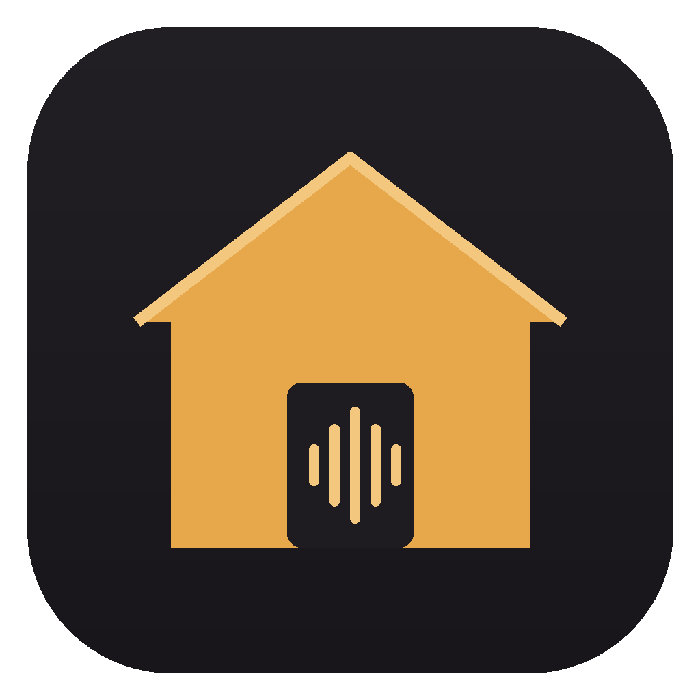

<p align="center"></p>

# Galpon

**Estudio de música libre para Mac y Windows**, con un modo para practicar guitarra y bajo tocando canciones. Graba voces e instrumentos, mezcla, edita y exporta. Tiene amplificadores y efectos propios, capturas NAM (TONE3000), un baterista automático y separación de pistas con IA. Toda la interfaz está en español.

- **Windows**: baja el instalador desde [Releases](../../releases), o el último build desde [Actions](../../actions).
- **Mac**: se compila en un par de comandos (ver [Compilar](#compilar)).

Versión actual: **0.11**.

---

## Qué hace

### Estudio

- **Pistas** de instrumento, de audio (voz, guitarra, bajo), de **baterista automático** y **buses**.
- **Cualquier interfaz de audio**: CoreAudio en Mac; WASAPI y **ASIO** en Windows. Puedes elegir entrada y salida por separado, frecuencia, búfer, canales, entrada mono o estéreo y monitoreo por pista.
- **Latencia** visible (entrada, salida, ida y vuelta) y compensada al grabar, con ajuste manual.
- **Instrumentos propios**: piano, piano eléctrico, órgano, sintetizador y batería. Hay un **sampler** SFZ con instrumentos grabados que se descargan con un clic: piano de cola, batería acústica, bajo y guitarra acústica.
- **Efectos propios**: ecualizador, compresor, puerta de ruido, distorsión, amplificador, **Amp NAM** (capturas `.nam`), gabinete IR, chorus, delay y reverb.
- **Plugins AU y VST3**, con su propia ventana y compensación de demora.
- **Baterista automático** con más de 35 estilos en 8 géneros (rock, metal, pop, funk y soul, hip hop y electrónica, latino, jazz y blues, country y folk): punk, thrash con doble bombo, death metal con blast beat, trap, cumbia, cuarteto, bossa, reggae y más. Sencillo/complejo, suave/fuerte, redobles y swing. Toca como una persona: mantiene un groove, lo varía al final de cada frase y hace redobles distintos. Escucha la guitarra o el bajo que grabaste: marca sus golpes con el bombo y toca más fuerte o más suave según cómo toques.
- **La canción por partes**: el baterista arranca con la canción armada (intro, estrofa, estribillo, estrofa, estribillo, puente, estribillo y final), una región por parte. Cada una se alarga, se mueve o se genera de nuevo sin tocar las demás. Toca cada parte distinto, entra con un platillo, hace un redoble antes de cada cambio y termina con un golpe final.
- **Batería acústica real**: con un clic baja una batería grabada con varios micrófonos (CC0) y el baterista la usa en lugar de la sintetizada.
- **Loops** que siguen el tempo y el tono, **editor de notas**, **teclado en pantalla** y teclados MIDI.
- **Automatización** de volumen, paneo, envíos y cualquier control de efecto, dibujada o grabada.
- **Mezclador** con envíos y buses, y limitador en el master.
- **Identificar acordes** de audio o MIDI, en una pista de acordes editable.
- **Flex**: afinar voces (automático o nota por nota), cuantizar audio y seguir cambios de tempo, sin perder la grabación original.
- **Separar en pistas** (voz, batería, bajo, otros) con Demucs, en tu computadora.
- Importa WAV, AIFF, FLAC, MP3, M4A y MIDI. Exporta a MP3, M4A, WAV, AIFF y FLAC.

### Grabación a prueba de sustos

- Cada toma va directo al disco (WAV de 32 bits flotante) con un colchón de 20 segundos.
- Si se corta la luz, se cuelga la computadora o se desconecta la interfaz, lo grabado queda guardado. Al abrir, Galpon ofrece **recuperar las grabaciones sueltas**.
- Antes de grabar revisa el espacio en disco y la entrada. Mientras grabas no deja hacer nada que arruine la toma.
- La canción se guarda al terminar cada toma y siempre hay una copia de la versión anterior.
- Si la app llegara a cerrarse sola, deja un informe y lo muestra la próxima vez que la abres.

### Modo Juego

Practica guitarra o bajo tocando canciones, al estilo de los juegos de ritmo.

- Lee canciones **`.feedpak`** (y `.sloppak`), el formato abierto de [feedBack](https://github.com/got-feedback/feedback). No abre ni descifra archivos de otros juegos.
- **Dos vistas**:
  - **Tablatura (2D)**: las notas llegan de derecha a izquierda.
  - **Mástil en 3D**, como en Rocksmith: la cámara detrás del mástil mirando un camino largo, la zona de la mano enmarcada en celeste, la cuerda más grave arriba y el número del traste debajo de cada nota. La cámara sigue la mano con suavidad.
  - **Las dos a la vez**: el 3D arriba y la tablatura abajo.
- **Técnicas como en Rocksmith**: slides que cruzan al traste de destino, bends con flecha, ligados (nota hueca), armónicos (rombo), palm mute (franja oscura), vibrato y trémolo.
- **Notas en inglés (C D E) o en español (Do Re Mi)**, a elección, en el estudio y en el juego.
- El orden de las cuerdas se puede poner como tablatura o con la grave arriba. El tamaño se ajusta con − y +.
- Muestra acordes, notas largas, bends, slides, ligados, palm mute, armónicos, vibrato, partes de la canción, letra y un diapasón con la posición de la mano.
- **Te escucha y te da puntos**: reconoce las notas y acordes que tocas, si llegaste a tiempo y si mantuviste las notas largas. Lleva racha, multiplicador y precisión. Al final ves un resumen por parte y puedes practicar la parte que más te costó.
- **Práctica**: más despacio sin cambiar el tono (30–100 %), repetir A–B o una parte entera.
- **Volumen** del Master, de cada instrumento de la canción y de tu guitarra. Hay un atajo para bajar o quitar la guitarra (o el bajo) de la grabación y escucharte mejor, y puedes elegir cuánto baja la canción cuando tocas fuerte.
- **Sonido automático**: arma los efectos que pide cada parte (limpio, distorsión, solo…) y los cambia solo. Si el nombre del sonido no lo dice, escucha la guitarra de la canción para saber cuánta distorsión lleva. Si conectas tu cuenta de **TONE3000**, usa las capturas que marcaste como favoritas.
- Afinador con la afinación de la canción y ajuste de sincronía.

## Atajos

| Tecla | Acción |
|---|---|
| Espacio | Reproducir / detener |
| R | Grabar |
| X · B · E | Mezclador · Controles · Editor |
| C · K | Ciclo · Metrónomo |
| Y · O | Biblioteca · Loops |
| ⌘/Ctrl K | Teclado en pantalla |
| ⌘/Ctrl Z · ⇧⌘/Ctrl Z | Deshacer · Rehacer |
| ⌘/Ctrl D · T | Duplicar · Dividir región |
| ⌘/Ctrl S · E | Guardar · Exportar |
| Juego: Espacio · ← → · ↑ ↓ · L · V · + − | Tocar · Saltar · Velocidad · A–B · 2D/3D/las dos · Tamaño |

## Compilar

Necesitas **CMake 3.22+** y un compilador de C++20. La primera vez se descargan JUCE y las demás dependencias; tarda unos minutos.

### Mac

```
./scripts/build_mac.sh --install
```

Si falta, el script instala CMake con Homebrew, compila, corre las pruebas e instala Galpon en Aplicaciones. Si te pide las herramientas de desarrollo de Apple, acéptalo y vuelve a ejecutarlo.

### Windows

Instala **Visual Studio 2022** (o sus *Build Tools*) con «Desarrollo para el escritorio con C++» y **CMake**. Después, en PowerShell:

```
.\scripts\build_windows.ps1
```

Deja `Galpon.exe` en `build\Galpon_artefacts\Release`. CMake baja solo el SDK de WebView2 y el SDK de ASIO de Steinberg.

## Cómo está armado

```
src/engine/   Motor de audio en C++ (JUCE): dispositivos, transporte, mezcla, grabación,
              instrumentos y efectos, plugins, NAM, baterista, Flex, stems, modo juego.
src/app/      La ventana: muestra la interfaz web y la conecta con el motor.
ui/           La interfaz (HTML, CSS y JS sin herramientas extra). ui/dev/mock.js simula
              el motor para abrir ui/index.html en un navegador.
tests/        Pruebas del motor: renderizan canciones sin necesitar una interfaz de audio.
assets/       Ícono.
```

Para cambiar la interfaz sin recompilar, abre la app con la variable `GALPON_UI_DIR` apuntando a la carpeta `ui`.

## Licencias

Galpon es software libre bajo la **GNU AGPL v3** (ver [LICENSE](LICENSE)).

Usa estos componentes, cada uno con su licencia:

- **JUCE**: AGPLv3.
- **Neural Amp Modeler Core**: MIT.
- **Eigen**: MPL 2.0.
- **shine** (MP3): LGPL 2.
- **Signalsmith Stretch**: MIT.
- **demucs.cpp** y los pesos de **Demucs**: MIT.
- **SDK de ASIO de Steinberg**: GPLv3. ASIO es una marca de Steinberg Media Technologies GmbH.
- **SDK de WebView2 de Microsoft**: licencia BSD.
- Ejemplos de la especificación **feedpak** en `tests/data`: MIT.
- Instrumentos que se descargan desde la app:
  - Splendid Grand Piano: dominio público.
  - Virtuosity Drums: CC0.
  - Black and Blue Basses y Shinyguitar: Karoryfer Samples.

Los sonidos, loops y patrones propios se generan por síntesis.
